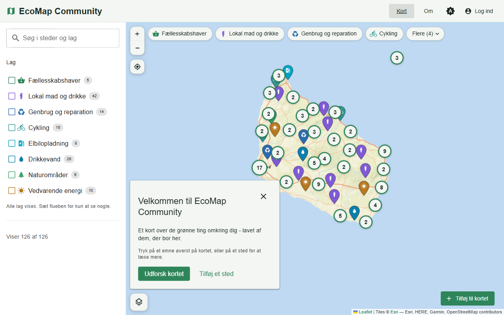
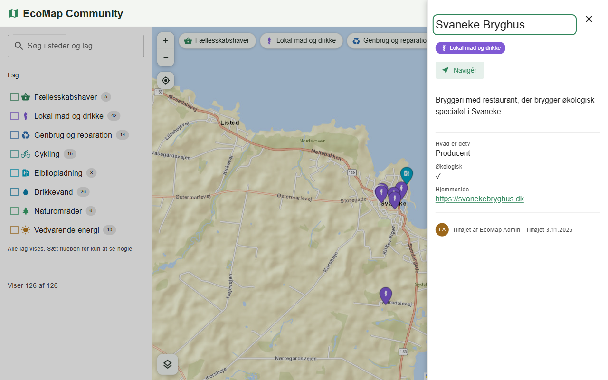
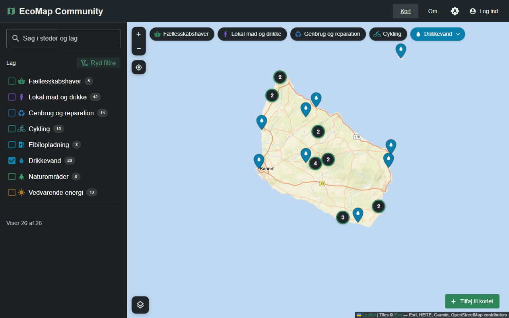

# EcoMap Community

**A community map of the green things happening around you** — farm shops and roadside stalls,
repair cafés and second-hand shops, cycling, drinking water, nature areas and renewable energy.
People who live there add the places; moderators keep it trustworthy.

It is **generic by design**: one codebase that any town, island, municipality or NGO can run as
its own map. The first community is the island of **Bornholm** in Denmark.



| A place, with opening hours, fields and directions        | Dark mode, filtered to drinking water             |
| --------------------------------------------------------- | ------------------------------------------------- |
|  |  |

---

## What it does

- **Layers instead of hard-coded categories.** An admin creates each topic: name, icon, colour,
  whether people add a place, a route or an area, and which extra questions they answer (opening
  hours, "organic?", a website…). The legend, filters and forms all follow from that.
- **Built by the community, kept honest by moderators.** Members add places and suggest changes to
  any place; moderators approve with a before/after view. Nothing reaches the public map unreviewed.
- **A map people can actually use.** Grouped pins, topic chips, search across places and layers,
  "open now" from real opening hours, directions via Google Maps, photos, free background maps
  (streets, satellite, topo, cycling) and "show my location".
- **Installable on a phone** as an app (PWA), with an offline fallback.
- **Accessible.** Checked against WCAG 2.2 AA in light and dark mode: everything works from the
  keyboard (including adding a place without a mouse), colours are shaded automatically so no
  colour choice breaks contrast, and reduced motion is respected.
- **Accounts done properly.** Invitation links, roles, blocking, two-factor authentication,
  profile pictures, and a privacy page each community fills in.
- **Shareable views.** Every filter lives in the URL, so a filtered map is a link.

## Generic by design: one codebase, any community

Nothing in the code is tied to a place. Everything that makes a map "Bornholm" lives in that
deployment's **database**, and an admin changes it in the app: name, colours, texts, start view,
the region where people may add places, layers, and who may join.

A community starts from a folder in [`apps/api/src/communities`](apps/api/src/communities), which
the seed writes into the database:

```
apps/api/src/communities/
  bornholm/        The Bornholm map: 12 Danish layers, 127 places from OpenStreetMap,
    index.ts       its settings (language, start view) and its About text
    layers.ts
    places.ts
    about.ts
  neutral/         A blank start for anywhere: 5 English layers, no places
  index.ts         The list of communities the seed knows
```

```bash
COMMUNITY=bornholm npm run db:seed   # or set COMMUNITY in .env
```

The seed is safe to run again: it only adds what is missing, and never overwrites a layer or a
setting an admin has changed.

**Starting a map for another place:**

1. Copy `communities/neutral` to `communities/<your-place>` and edit the layers, settings and
   (optionally) places — or keep it neutral and set everything up in the app.
2. Add it to `COMMUNITIES` in `communities/index.ts`.
3. Deploy the same code with its own database and `COMMUNITY=<your-place>`.

Each community is its own deployment with its own database and admins; the code stays shared.

## Quick start

You need **Node 22+** and **Docker** (for PostgreSQL + PostGIS).

```bash
npm install            # installs every workspace and builds @ecomap/shared
cp .env.example .env   # change JWT_SECRET; set COMMUNITY=bornholm for the Bornholm map
npm run setup          # starts the database, migrates it, seeds the community
npm run dev            # API on :4000, web app on :5173
```

Open <http://localhost:5173>. The seed creates a superadmin account from the `SEED_ADMIN_*` values
in `.env` (`admin@ecomap.local` / `ChangeMe123!` by default).
**Change them before this ever leaves your machine.**

## Tech stack

| Part     | Built with                                                                 |
| -------- | -------------------------------------------------------------------------- |
| Web app  | Vue 3.5, Vuetify 4, Leaflet, TanStack Query, i18next (Danish and English)  |
| API      | Express 5, PostgreSQL 17 + PostGIS, plain SQL migrations                   |
| Shared   | Zod schemas, domain types and permission rules used by both sides          |
| Language | TypeScript 7 (native compiler), `strict` plus the stricter extras          |
| Quality  | Vitest, Testing Library, end-to-end API tests against real PostGIS, ESLint |

```
apps/
  api/        Express 5 REST API, PostgreSQL + PostGIS, the communities and the seed
  web/        Vue 3.5 + Vuetify 4 + Leaflet
packages/
  shared/     Zod schemas, domain types and the permission rules, used by both
```

`packages/shared` is why the two halves cannot drift apart: the same schema validates the form in
the browser and the request on the server, and the same `canEditFeature()` decides whether the
edit button shows and whether the API allows the edit.

## Commands

All run from the repository root.

| Command                     | What it does                                                      |
| --------------------------- | ----------------------------------------------------------------- |
| `npm run dev`               | Shared package watcher, API and web app together                  |
| `npm run build`             | Production build of all three                                     |
| `npm run verify`            | Format check, lint, typecheck and every test — run before commit  |
| `npm test`                  | Tests only                                                        |
| `npm run db:up` / `db:down` | Start / stop the PostGIS container                                |
| `npm run db:migrate`        | Apply pending SQL migrations                                      |
| `npm run db:seed`           | Admin account, then the `COMMUNITY`'s settings, layers and places |
| `npm run db:reset`          | Throw the database away and rebuild it from scratch               |

## How it works

### Data model

- **Layer** — a topic. Slug, name, icon, colour, which of Point / LineString / Polygon it accepts,
  whether contributions need review, and its own field definitions.
- **Feature** — one thing on the map. A PostGIS `geometry(Geometry, 4326)`, name, description,
  photos, and `properties` validated against its layer's fields.
- **Suggestion** — a proposed change to a feature, waiting for a moderator.
- **Community settings** — one row: name, tagline, About and privacy texts, colours, language,
  background map, start view, and the area contributions must fall inside.
- **User** — email, password (scrypt), role, optional TOTP secret, optional picture.

### Roles and permissions

Route handlers never check a role; they check a **permission**, and roles are bundles of
permissions defined once in `packages/shared/src/permissions.ts`, for both the API and the UI.

| Role          | Can                                                              |
| ------------- | ---------------------------------------------------------------- |
| `viewer`      | Look at the map                                                  |
| `contributor` | Add places and suggest changes; everything waits for review      |
| `moderator`   | Publish directly, edit anything, approve or reject contributions |
| `admin`       | Manage layers, settings and people (block, temporary passwords)  |
| `superadmin`  | Assign roles                                                     |

### Authentication

- Passwords are hashed with **scrypt** from Node's standard library; the cost parameters live in
  the stored hash, so they can be raised later without invalidating passwords.
- Sign-in returns a short-lived **access token** (JWT) kept _in memory_ and sent as
  `Authorization: Bearer`, so authenticated endpoints are immune to CSRF by construction.
- A **refresh token** lives in an httpOnly, `SameSite=Strict` cookie scoped to `/api/auth`; the
  database keeps only its SHA-256 hash, and every refresh rotates it.
- **Two-factor authentication** is TOTP (RFC 6238) on `node:crypto`, tested against the RFC's
  reference vectors.

### Tests

| Package           | Tests | Covers                                                            |
| ----------------- | ----- | ----------------------------------------------------------------- |
| `packages/shared` | 101   | Schemas, permission rules, geometry helpers                       |
| `apps/api`        | 127   | Unit tests plus end-to-end tests over HTTP against a real PostGIS |
| `apps/web`        | 122   | API client, URL filters, drawing, forms, contrast, translations   |

The API's end-to-end tests use the database named by `TEST_DATABASE_URL`, creating it on demand
and truncating between cases. Without that variable they skip themselves, so `npm test` still
passes on a machine without Docker.

## Deployment notes

- `npm run build` produces `apps/api/dist` (run with `npm start`) and `apps/web/dist` (static
  files for any web server or CDN).
- Serve both from one origin, or set `CORS_ORIGINS` to the web app's origin. The refresh cookie is
  `Secure` when `NODE_ENV=production`, so the site must be on HTTPS.
- The API runs its own migrations at start-up; run `npm run db:seed` once with the right
  `COMMUNITY`.
- Background maps are free, keyless tile services. For a busy public site, check each provider's
  usage policy or move to a paid or self-hosted service.
- PostgreSQL, PostGIS, OpenStreetMap and everything else here are open source and can be
  self-hosted inside the EU.

## Data and credits

The Bornholm places come from [OpenStreetMap](https://www.openstreetmap.org/copyright)
(© OpenStreetMap contributors, ODbL). Each place keeps its OSM id, so it can be traced back to its
source. Map tiles © their providers, credited in the map's corner.

## Licence

[GNU Affero General Public License v3.0 or later](LICENSE) © 2026 Martin Bures.

Any community may run, change and share EcoMap. If you run a modified version as a website, you
must offer its source code to the people using it - so improvements stay open for everyone.

## Deliberately left for later

- The `bbox` query parameter exists on `GET /api/features` (backed by a GiST index), but the web
  app loads all matching features at once. Wire the viewport to it when a community outgrows that.
- The About and privacy texts support only a small Markdown subset (headings, lists, bold, links),
  rendered as elements and never as HTML — admin-written HTML would be a stored XSS waiting for
  the first compromised account.
- No email yet. Invitations are links an admin copies and sends, and someone who forgets their
  password gets a temporary one from an admin; reset by email comes later.
- No self-service account deletion: the privacy page tells people to ask an admin.
- `backend/` is the first version's Express server. It is no longer built or linted, and
  `apps/api` covers everything it did; delete it once you are happy to.
